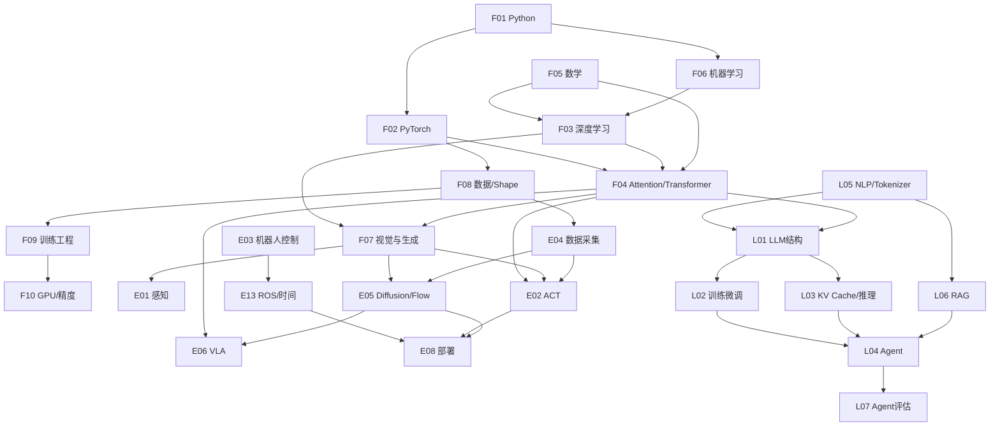

# v0.2 · 知识依赖审计（第一轮）

> 审计基准：F01–F12、E01–E12、L01–L11 的 v0.1 地图；2026-11-06。依赖关系是教学设计建议，不代表所有论文/模型的唯一理论前置。状态“覆盖”表示地图有入口，不表示已有课程笔记或已经掌握。

## 审计方法与判定

- **结构覆盖**：知识地图是否存在主题及明确归属？
- **前置闭合**：是否能找到所有必要的前置知识入口，并按合理顺序解释？
- **可检验**：是否有公式、shape/代码或问答来判断真正理解？
- **复用**：F 系列只保留一份；E/L 链接，避免两份不同版本。
- **待完成**：将依赖映射变成真正的笔记间链接，需等正文笔记建立后逐篇核实。

## 核心依赖图（箭头表示应先学习左边）

注：这是一张**最小核心依赖图**，不是严密的数学证明。例如 F07 的 U-Net 部分不要求先学 Transformer；L04 Agent 可以提前做 API 直观体验，但要理解底层机制仍需 L01/L03。

## 关键路径核查

| 目标知识 | 必要的前置 | 之前问题 | 本轮处理与验收门槛 |
|---|---|---|---|
| Dropout / AdamW / BatchNorm | F03 过拟合、梯度、统计量 + F02 train/eval | 概念易混淆 | 概念解释、训练/推理对照代码、辨析 weight decay |
| Self- / Cross-Attention | F05 矩阵/softmax + F02 shape + F03 反向传播 | 只背 QKV 而不会算维度 | 手写 [B,H,T,D] 和 cross-attn Q/K/V 长度、mask |
| ViT / 图像 Encoder | F07 CNN/patch + F04 Attention + F08 图片维度 | 忽略相机排序和 patch 数 | 从 HWC 到 [B,V,N,D] 的维度表 |
| VAE/CVAE | F05 概率与 KL + F03 loss + F07 encoder/decoder | ELBO 与 CVAE 条件不明确 | 解释 reparameterization、KLD 与训练/推理 latent |
| ACT | F04 Transformer + CVAE + E04 数据窗口 | action chunk 与执行步数混淆 | 从数据/配置追踪 [B,T,A]，验证 ensembling |
| U-Net / Diffusion Policy | F07 卷积/U-Net、噪声与采样 + E04 时序 | 易把预测窗口当执行窗口 | 逐一解释 horizon/obs/action steps 与 scheduler |
| Flow Matching / π0.5 | F05 ODE/概率 + F07 Flow + E06 VLA | 只会术语，不知损失与动作专家 | 说明速度场、时间采样、配置与 action_dim |
| Joint ↔ EE 控制 | F05 线代/Jacobian + E03 FK/IK | 单位/坐标和动作含义漏检 | 同一动作在角度、弧度、米、增量下如何映射 |
| ROS Rate / Timer / spin | F01 Python + E03 控制周期 + F08 时间戳 | **缺独立 P0 入口** | E13 专题 + ROS Rate 原子笔记 + 命令测实际频率 |
| GPU / mixed precision | F02 dtype/device + F09 训练 + F10 硬件 | 利用率与吞吐量易混为一谈 | 控制 batch/shape/dtype 的同步测量和峰值显存 |
| LLM / causal mask | F04 Attention + L05 tokenizer/概率 | 可能直接跳 Agent | 从 token ID 到 logits、labels shift、mask 维度 |
| KV Cache | L01 自回归 + F04 Q/K/V + F10 显存 | “缓存 attention”表述不精确 | 推导 K/V shape 和内存，说明 prefill/decode |
| LoRA / QLoRA | F05 矩阵秩 + F02 requires_grad + L01 Linear | 会调 rank，不能计算参数量 | 手算 BA 低秩层规模，验证 trainable_params |
| RAG | L05 embedding + F06 检索评价基础 | 将 RAG 等同于大模型训练 | Recall@k/MRR、chunking、引用溯源 |
| Agent 工具调用 | L01 生成 + L06 检索(按需) + F01 API/异常 | 框架会用，工具故障无法分析 | 构建有限循环、trace、异常重试、权限边界 |

## 首批学习门槛（建议验收，不是强制考试）

1. F02/F08：用文字/打印解释 RGB [B,V,C,H,W]、机器人动作 [B,T,A] 的每一维，并证明数据维度没有意外交换。
2. F03/F04：区分 model.eval() 与 no_grad()；在纸上推导 [B,H,Tq,Tk] 注意力权重。
3. E02/E05：明确模型的预测窗口、实际执行窗口和重规划频率，避免参数名相同就认为行为相同。
4. E03/E13：写出 10 Hz 循环的目标周期，说明超时后不能“保证10 Hz”；测量 topic 实际速率和消息滞后。
5. L01/L03：解释 Prefill、Decode 与 KV Cache，比较有无缓存的输出和显存。
6. L04/L07：让 Agent 面对失败工具请求，保存并评估每一步轨迹。

## 明确的缺口与后续处理

- [x] **A1**：E13 ROS 通信/时间/执行机制原先无独立章节，补成 P0 模块。
- [x] **A2**：将依赖关系与可验证学习门槛写入本文件，供两条路线共用。
- [ ] **A3**：为每个 P0 的原子笔记建立经过验证的相对链接；当前大多数知识点仍只是地图条目。
- [ ] **A4**：按学习情况做前置测试，不能仅凭“之前做过项目”自动标为已掌握。
- [ ] **A5**：每次重要实现版本变化时校验配置参数（尤其 LeRobot ACT、DP、openpi）。

返回：[主页](../README.md) · [工程审计](41-engineering-audit.md) · [面试覆盖](42-interview-coverage.md)